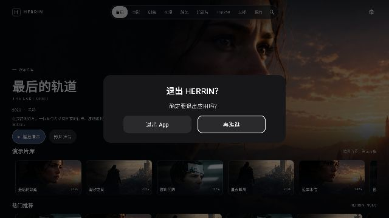

# Herrin TCL 真机反馈 P0 修复记录

基线：0.4.65-alpha / `2af99374ab44052bb8ab6c76daeed5e94d75bd3d`。本轮候选为 **0.4.66-alpha (70)**，继续在 `codex/herrin-responsive-config-20261106` 和 [Draft #81](https://github.com/shawnhhh/aura-tv/pull/81) 开发，不合并 master。FongMi [Draft #80](https://github.com/shawnhhh/aura-tv/pull/80) 仍是 f02fc8d；新出现的 Apple Draft #82 修改独立目录，不与 Android 文件重叠。已通过 Git 获取全部远端 refs；没有可读取其他 Codex 会话内部运行状态的接口，不能保证跨会话任务状态，但推送始终使用非 force 更新以保护其他提交。

本轮未调用任何 Superpowers 工具或工作流。首页整体视觉、FongMi 核心、HDR/杜比视界/解码及 original 背景策略保持。

## 已确认的代码缺陷与修复

**真机根因未确认。** 尚未取得用户 TCL 的实际异常堆栈；不能把以下可复现代码缺陷直接认定为所有 TCL 闪退的唯一原因。401 输入错误已经解决，不作为当前主要故障。

1. **刮削后最近播放栏的 key 身份不一致。** 最近列表先按原始 Film.id 去重，LazyRow 却用 ShowGroup.key；成功刮削把未知分类改为剧集、合并同一 TMDB 剧集后，多个来源影片可能拥有同一个列表 key。新增 20/100/250 条回归明确构造“刮削前 key 唯一、刮削后旧 key 重复”的场景，生产路径改为 ShowCatalog.recentRail，以同一个分组身份折叠。来源 ID、原始选集和线路保留。
2. **成功探测后续请求异常可以逃出页面恢复分支。** ArtworkAuthenticationFailure / ArtworkRateLimitFailure 原来不是 IOException，首页/详情协程只捕获 IOException；后续 401/403/429 因而可能未被页面处理。改为有明确类型的 I/O 错误，同时端点路由显式禁止对认证/限流错误切换域名。既有状态、次数和主备回退断言保留。
3. **损坏的单片详情 JSON 可能抛出未处理的 JSONException。** 仅在该解析边界拒绝异常响应并保留当前 Film，不清空片库、不改变来源/播放字段。
4. 图片内存不足作为局部可恢复失败：释放网络/解码许可、淘汰可复用缓存引用，不立即重试，不 recycle 正在由界面持有的 Bitmap；新增合成 OOM 回归。未以捕获 OOM 宣称真实 TCL OOM 根因已被确认。
5. 历史/剧集进度排序投影移到 Default dispatcher，按目录隔离并取消过期结果，避免批量资料更新时反复在 UI 线程遍历选集和读取历史。
6. 压力回归发现综艺发现请求直接拼接 `10764|10767`，不符合严格 URI 解析。生产地址改为 `10764%7C10767`，保留 TMDB 的 OR 过滤语义，并新增所有发现端点的 URI 合法性及解码语义断言。这是回归测试揭示的代码问题，不据此宣称就是 TCL 闪退堆栈。

## 脱敏诊断

- HerrinApplication 安装有界未捕获异常记录器；记录错误类型、受信命名空间的类/方法/行号，最多 4 层原因、每层 20 帧、10000 字符。**不记录异常消息、源文件路径、线程名、影片名、URL、Cookie、Token 或密码。** 外部动态类名/方法脱敏。
- 最后 TMDB 阶段、栏目、图片任务数、位图缓存字节和堆内存指标在正常路径采样；约每 5 秒写入不含业务凭据的运行检查点。
- 崩溃处理仅尝试小型本地写入，然后始终转交原 Android fatal handler；不全局吞异常、不在处理器内联网、重启业务或执行复杂诊断。
- Android 11+ 的 HistoricalProcessExitReasons 显示时间戳、Java/native crash、ANR、低内存或用户请求等原因和 PSS/RSS；不复制 OS 的原始 description/trace，以免泄漏来源数据。
- 下次启动后通过「高级工具与诊断 → 查看设备状态 / 复制设备状态」查看与复制。Java 记录、OS 原因及检查点应按时间戳一起判断；不是每次异常都能成功落盘，native/系统回收无法保证经过 Java handler。

## 启动黑屏

基线 Starting Window 为纯黑，而完整 Herrin 首页及其仓库初始化先于启动字标组合，扩大了无反馈窗口。

- StartupHost 先组合轻量矢量字标；字形已实际进入绘制后再准备首页。
- 首次 Token Keystore 解密/迁移、已有偏好和历史预热放到 IO；显示模式请求离开 onCreate 首帧前路径。
- 保留固定位置/尺寸/字距、白字黑底、1800ms 中心向两侧渐显；完整显现前无呼吸，完整后统一轻微呼吸；首页控件可获得焦点后计为交互就绪。
- 网络离线使用已有缓存/离线内容，不等网络图片或 TMDB 才显示字标。没有加入额外固定延时来遮盖黑屏。
- 分别采集 process→onCreate、onCreate→首次 CPU 绘制、首次绘制→字标可见、完整字标、首页可交互。process→Activity 在 warm 场景表示进程已存活时长，**不是遥控器点击延迟**；点击/系统启动边界用 am start 的 LaunchState / TotalTime 对照。
- 冒烟覆盖冷启动、后台恢复及真正退出 Activity 后重新进入。显示模式切换和系统启动窗口造成的 TCL 实际黑屏仍需设备复测，不能仅凭代码声明完全消除。

## 扫码入口与弹窗

- 普通「设置 → 内容来源」顶部直接显示「手机扫码配置」，与返回按钮同一行，遥控器可聚焦；TMDB 操作区增加「扫码输入 Token」。高级入口保留，三处都使用同一个 LanConfigDialog/HTTPS 服务。
- 独立模态 Dialog 双栏显示二维码、地址、完整 SHA-256 指纹和说明，避免被 LazyColumn 裁剪；关闭/返回/失败立即结束会话与服务。
- 没有 IPv4、服务启动失败、二维码失败均有明确提示和重试；保留遥控器手动输入。
- 复用 TMDB、影视源/已有目录、M3U/EPG、多 WebDAV NAS 管理。未新增 SMB/NFS 声明。
- 保留高熵一次性凭据、电视确认、独立闲置管理会话、临时 HTTPS 和 Keystore。没有关闭证书校验、没有信任全部证书、没有明文密码路径。
- 自签名 HTTPS 在 Safari/Chrome 仍需人工建立信任；无法核对电视完整指纹时应使用手动配置，不声明无障碍扫码已被真实手机验收。

## 退出确认及返回层级

- 首页、电影、剧集、动漫、综艺、纪录片、Top250、我的和直播浏览一级页面 Back 显示「退出 HERRIN？」/「确定要退出应用吗？」。
- 两按钮「退出 App」「再逛逛」使用同一组件：深灰 #2A2A2C、白字、224×58dp、16dp 圆角、相同字号和内边距。焦点仅添加白色描边，不换底色或布局；默认「再逛逛」。
- 左右自然切换；取消与弹窗 Back 保持栏目、焦点和滚动；短时间重复/长按 Back 不叠加对话框、不直接退出。
- 退出仅 Activity.finish()，由已有生命周期释放资源；不 System.exit、不杀进程、不清除配置/历史/缓存。
- 播放、详情、搜索、设置、选集、线路、直播播放和二维码弹窗保留子级返回优先；搜索编辑和直播搜索优先关闭子状态。
- 新增像素采样验证两个按钮基础颜色相同、真实 Activity.finish 验证、截图及数据保留断言。旧冒烟中“电影 Back 强制回首页”的断言按新需求改为“确认弹窗→默认取消→仍为电影”，并新增真正退出/重新进入断言。

## 验证状态

- 已完成本地 XML/Manifest/官方 wrapper/原生边界结构检查、JS 语法及 13 项脚本 Python 单测。
- 真实基线 CI [42186651485](https://github.com/shawnhhh/aura-tv/actions/runs/42186651485)：582 JVM、212 TV 测试通过，无 FATAL；这是旧版基线，不能冒充 0.4.66 的结果。
- 本轮首个中间编译发现 StringBuilder→String、实验性焦点 API 注解和命名回调绑定问题，已修正，保留失败记录 [42228029934](https://github.com/shawnhhh/aura-tv/actions/runs/42228029934)。
- 本轮回归包含：刮削前后身份与来源字段、损坏详情、后续认证/限流、实际探测/发现/缓存/发布链路的百条资料与 250 榜单、重复 ID、缺失/无效图片、快速分类与按键、退出详情、断网和 Activity 重建；图片缓存合成 OOM、仍被使用的 Bitmap 生命周期；九个一级栏目退出、默认/左右焦点、灰色像素、快速/长按返回、真正 finish；扫码显示/关闭/无 IPv4/失败重试。
- 其余原有 MP4/HLS、NAS/WebDAV、音轨/字幕、历史、Hero、Top250、图片与遥控器测试完整保留。
- 中间运行 [42233282438](https://github.com/shawnhhh/aura-tv/actions/runs/42233282438) 的 Debug/Lint/586 JVM 通过，TV 测试 215/222 通过、7 项失败。三项旧返回用例仍期待一级 Back 回首页、两项新二维码用例把“包含”写成整段精确匹配、两项批量用例暴露上述未编码 URI。已修正请求及用例：明确验证退出弹窗、默认取消和保留栏目，保留影视/直播断言；没有删除或跳过测试。截图收集错误不再覆盖原始断言异常。
- Chromium 手机尺寸页面回归在本轮重新通过：1 次配对、4 模块、20 次 Mock 请求、Token 输入框保存后清空、会话结束。此项只验证前端和合成 API，不代表真实手机、自签名证书或电视网络已通过。
- 最终代码候选 `c4a05606338992f66f684e8e0c261179b58bc671` 在 [42237672986](https://github.com/shawnhhh/aura-tv/actions/runs/42237672986) 的 Debug/Lint/assembleDebug 通过，587 JVM 全通过，0 失败/错误/跳过。TV 作业另行核对，不把 Debug 作业中的 Android TV=0 当作 TV 通过。
- 同一提交的 **222 项 TV instrumentation 全通过，0 失败、0 跳过**；完整套件门禁通过。包括本轮新增压力/恢复/扫码/退出用例及已有真实合成 MP4/HLS 解码、音轨、字幕、WebDAV、来源、焦点、缓存与 Hero 回归。日志未观察到 `FATAL EXCEPTION`；这不是完整的 native crash、ANR 或内存泄漏证明。
- [TV 全部截图、JUnit XML、日志和测量原始产物](https://github.com/shawnhhh/aura-tv/actions/runs/42237672986/artifacts/13516785628)。完整结构数据见 `P0_20261106_AFTER.json`。
- 本地结构/上游源码完整性检查、13 项 Python 脚本单测、14 项 native 边界 fixture 测试、Shell/JS 语法通过。native 负向 fixture 输出的 BLOCKED 是预期拒绝损坏输入，不代表真机 native 解码验证。

## APK 与签名

- 版本：0.4.66-alpha，versionCode 70。
- 构建提交：`c4a05606338992f66f684e8e0c261179b58bc671`。
- [最新 Debug APK ZIP](https://github.com/shawnhhh/aura-tv/actions/runs/42237672986/artifacts/13514885279)，解压得到 `app-debug.apk`，26,426,385 字节。
- **APK 文件本身** SHA-256：`9cf8f5ab0a1757df630b1798cdf50c4133386967059e46d9e4aa0986d11990bf`。与下载 ZIP 的摘要不同。
- [JVM/Lint/构建报告](https://github.com/shawnhhh/aura-tv/actions/runs/42237672986/artifacts/13513545450)。APK 产物预计保留至 2026-11-20，需要有仓库访问权限的 GitHub 账户下载。
- 本轮未取得用户旧 APK 的签名证书，不能承诺覆盖安装。应先核对签名；若签名不一致，先安排数据迁移/原签名构建，不能用“直接卸载”解决升级。Keystore 凭证不能保证可跨卸载迁移。

## 本轮修改文件

文件分组（相对 2af99374）：

- 应用与版本：`app/build.gradle.kts`、`app/src/main/AndroidManifest.xml`。
- 主流程与交互：`MainActivity.kt`、`StartupPresentation.kt`、`HerrinWordmarkSplash.kt`、`ExitConfirmation.kt`、`LanConfigDialog.kt`、`TvFocusRoutes.kt`。
- 元数据、图片和状态：`ArtworkMetadataResolver.kt`、`HerrinTmdbDiscovery.kt`、`TmdbEndpoints.kt`、`ShowGrouping.kt`、`FilmArtwork.kt`、`MetadataFetchers.kt`、`Preferences.kt`。
- 诊断：`CrashJournal.kt`、`MainExitDiagnostics.kt`。
- 自动化：`P0MetadataStabilityTest.kt`；Android 的 `HerrinUiSmokeTest.kt`、`P0ArtworkMemoryTest.kt`、`P0ExitAndEntryTest.kt`、`P0MetadataPublicationPressureTest.kt`、`P0QrFailureTest.kt`；`scripts/emulator_smoke.sh`、`scripts/emulator_report.py`、`scripts/acceptance_report.py`。
- 报告与证据：本报告、`P0_20261106_BEFORE.json`、`P0_20261106_AFTER.json`、`P0_20261106_ABBA.json`、`P0_20261106_EXIT.jpg`。
- 同机对照：`.github/workflows/p0-performance-ab.yml`、`.github/workflows/p0-performance-ab-recover.yml`、`.github/scripts/p0_performance_ab.sh`、`.github/scripts/p0_performance_ab.py`。

除说明完整路径的文件，其余 Kotlin 位于 `app/src/main/java/tv/herrin/app/` 或对应 test/androidTest 目录。本轮未修改 FongMi vendor、native playback、解码、HDR 或杜比视界代码。

## 本轮提交

| Commit | 内容 |
| --- | --- |
| 6cea3e5 | 稳定发布、启动首帧、扫码与退出确认的批量实现 |
| 7262dd9 | 压力、退出、扫码回归及编译集成修正 |
| 75c7847 | 完整 250 排名与首页重复 ID 的独立测试数据 |
| c5144e5 | 真正退出/恢复冒烟、启动分段、基线记录 |
| 382aca5 | 有界截图日志分块 |
| 747e04d | 加密偏好 IO 预热 |
| b0ca05d | 历史后台投影、图片 OOM 所有权和脱敏校验 |
| 54e8c83 | 异步历史状态按目录隔离 |
| 467400f | 真机边界报告及后台恢复断言 |
| b0b2a33 | 去除按钮焦点色层、扫码 Token 后台读取 |
| c4a0560 | 综艺 URI 编码及新返回规则的完整回归 |
| 656f85d | 同一主机/AVD、固定双版本的 A→B→B→A 性能对照 |
| 9c16d6e | 从原始 logcat 恢复四轮指标并逐轮核对测试结果 |

最终报告/JSON/截图的提交可由本报告所在 Git commit 或 PR Commits 页面核对。`c4a0560` 后没有应用代码变化，已验证后续 HEAD 的 `android-tv/app` Git tree 与被测试提交均为 `d3583bf8ca2bfa7003466ff45ab0dd2613e60b54`；后续只有测试工作流和文档证据，不把另一次构建的 APK 冒充交付产物。

图为 `b0b2a33` 中间候选的真实模拟器截图缩略图；该 ExitConfirmation 组件到最终 `c4a0560` 没有变化（已核对文件差异为空）。最终运行的系统缩略屏截图未完整捕获独立 Dialog 层，不能当作完整画面证据；最终的 Dialog 像素采样、相同底色/尺寸、焦点和功能断言全部通过。保留这一采集限制，不把截图处理成真机图。中间 [TV 运行](https://github.com/shawnhhh/aura-tv/actions/runs/42233282438) 与最终运行的原始截图均可复查；不是 TCL 截图。

## 优化前测量

完整数据：P0_20261106_BEFORE.json。设备为 **Android TV API30 x86 / tv_1080p 软件模拟器**，不是 TCL。

| 项目 | 2af99374 基线 | 本轮 |
| --- | ---: | ---: |
| am start 冷启动 TotalTime | 1924ms | 1858ms |
| onCreate→首次 CPU 绘制 | 基线未采集 | 389ms |
| 首次绘制→字标可见回调 | 基线未采集 | 585ms（onCreate 起累计 974ms） |
| onCreate→完整字标 | 基线未采集 | 2567ms |
| onCreate→首页首次获得交互焦点 | 基线未采集 | 3415ms |
| 左右焦点回调 P50/P95/P99 | 3.08/43.14/46.16ms | 4.89/32.42/51.64ms |
| 左右首个焦点 CPU 绘制 P50/P95/P99 | 11.71/30.92/46.93ms | 14.48/21.28/33.27ms |
| 上下焦点回调 P50/P95/P99 | 3.41/45.45/50.90ms | 3.46/7.74/9.65ms |
| 上下首个焦点 CPU 绘制 P50/P95/P99 | 16.23/50.86/51.98ms | 11.36/21.59/21.99ms |
| 水平窗口帧耗时 P95 | 172.69ms | 233.37ms |
| 60Hz 超预算帧 | 79/79（100%） | 79/79（100%） |
| 连续反向方向键 | 120 次，最终焦点正确，1919ms | 120 次，最终焦点正确，4329ms |

回调、CPU 绘制、合成帧耗时和屏幕呈现/光子延迟严格区分；不同 Actions 主机对比不构成严格同硬件单变量实验。P99 的 32/40 次采样也不代表充分的真机长尾统计。60/120/144Hz 策略测试不代表电视实际输出或持续渲染到 144fps。

**没有宣称所有性能指标改善或已经达标。** 首次独立 CI 对比中帧 P95、突发输入总时间上升、水平回调 P99 也上升；软件模拟器全部采样帧超预算。为排查代码影响与主机差异，追加固定基线/候选在同一 AVD 上的 ABBA 对照，结果另行记录，不删除上述较差样本。

冷启动 am start 统计只比基线少 66ms，不能由一次测量证明 TCL 黑屏已消除。新分段没有旧版同口径数据，不能虚构改善百分比。后台恢复 HOT TotalTime/WaitTime=326/378ms；真正结束 Activity 后 WARM 重进=484/493ms，其分段首次绘制292ms、字标可见再341ms、完整字标2245ms、首页2810ms。第二次 process→Activity=28149ms 是进程年龄，不是启动延迟。

刷新率策略的 60/90/120/144/165/240Hz、保持 4K 及播放让权测试通过。此次完整套件为 tv_1080p 软件 AVD，不具备真实 4K144Hz 显示链路；实际显示模式数据由追加对照收集，TCL 输出和物理屏幕帧率未验证。

## 同一模拟器 ABBA 对照与性能未通过项

[原始对照运行 42242155533](https://github.com/shawnhhh/aura-tv/actions/runs/42242155533) 使用同一主机、同一 AVD、相同分辨率/动画配置和逐文件比对一致的输入测试，依次 A1→B1→B2→A2。A=`2af99374`，B=`c4a0560`。每轮 5 项、合计 **20 项 instrumentation 全通过**，包括 40 次左右、32 次上下、120 次快速反向、110 次长按及松开稳定性、软件绘制基线。

首次汇总失败，原因是设备端指标路径被创建为目录，`adb pull` 得到空目录。四轮完整 logcat 与测试输出已保存；[恢复解析运行 42244273996](https://github.com/shawnhhh/aura-tv/actions/runs/42244273996) **成功**，严格核对每轮 OK(5 tests)/完成码以及全部指标字段，没有用空数据补零、跳过缺失项或重做较好样本。原始失败状态保留；修正后的解析器已对原始数据执行通过，未来采集改用 16M logcat。

[原始四轮日志、显示信息与恢复后的 JSON](https://github.com/shawnhhh/aura-tv/actions/runs/42244273996/artifacts/13517038690)，仓库副本 `P0_20261106_ABBA.json`。

| 指标（ms，除标注外） | A1 基线 | B1 候选 | B2 候选 | A2 基线 |
| --- | ---: | ---: | ---: | ---: |
| 左右焦点回调 P50/P95/P99 | 4.71/16.37/17.06 | 5.95/21.16/25.03 | 6.02/17.61/40.15 | 6.45/53.06/60.45 |
| 左右首个 CPU 绘制 P50/P95/P99 | 12.31/23.74/30.66 | 16.63/28.04/30.61 | 17.91/23.89/28.16 | 15.67/59.04/66.89 |
| 上下焦点回调 P50/P95/P99 | 4.66/14.06/19.37 | 3.47/20.33/23.44 | 5.41/11.66/21.91 | 5.28/12.54/20.74 |
| 上下首个 CPU 绘制 P50/P95/P99 | 16.22/26.59/32.07 | 15.84/29.31/39.99 | 14.37/25.11/28.42 | 12.74/23.10/25.17 |
| 水平窗口帧 P95 | 233.40 | 233.71 | 199.10 | 226.86 |
| 超 16.67ms 帧 | 79/79 | 79/79 | 80/80 | 79/79 |
| 120 次输入→最后正确焦点总时间 | 5706 | 6532 | 6349 | 5408 |
| 导航/强制重绘帧 P95 比值 | 1.02 | 1.35 | 1.20 | 1.15 |

**性能验收未通过，仍是 P0 未完成项。** 候选两轮突发输入总时间均高于基线；回调与绘制尾延迟有波动，全部软件窗口采样仍超预算，不能宣称“所有性能改善”“无性能退化”或达到成熟流媒体应用水平。总时间包括 OS 注入和最终焦点等待，不是单键延迟或松开后的积压时间；长按松开 500ms 后焦点保持断言四轮均通过。

核查本轮新增 KeyEvent/重组路径后，尚无堆栈/trace 能把差异归因到某个明确的新阻塞点；没有据此盲目降低图片质量、全局动画帧率或删掉诊断。两次候选/两次基线不足以作充分的长尾统计或证明因果。下一步需要 TCL 上同场景的系统 trace、CPU/GPU 时间、GC 与实际呈现数据定位；本环境没有连接该电视/ADB，属于真机测量阻塞。本轮保持 Draft，不把性能项目标记验收完成。

AVD 系统显示信息报告 **60.000004Hz**（约 60Hz），配置 1920×1080；仅有 60Hz 时策略保持系统选择，不制造 144Hz 请求。高刷新率选择的 4K144/更高值由单元测试覆盖，**不是实测设备模式**。软件窗口帧耗时也不能换算成可靠的持续显示 FPS，更不能作为 TCL 4K144fps 结论。真实电视应复制高级诊断中的当前模式、支持列表、窗口请求、帧 P50/P95/P99、累计 GC，以及上次退出摘要。

## 未完成或必须由设备继续验证

- TCL 闪退真实堆栈和确切根因（目前缺失），native/ANR/OOM 的实际分类。
- 遥控器性能目标仍未验收：同机模拟器候选突发输入总时间偏高，需系统 trace 和真实电视同机对照继续定位，不作为已解决项。
- 真机冷/热启动分段、系统 Starting Window 与 4K 显示模式切换黑屏；物理遥控器到屏幕呈现延迟、GC 单次暂停、真实帧时间和内存峰值。
- TCL 4K 144Hz 是否由系统开放、是否采用请求值，以及高刷新率是否损害输入；本轮保持策略，不以面板标称值宣称达标。
- Safari/Android Chrome 实际证书核对及单次扫码全过程；用户 NAS/影视源/直播源真实网络与权限；中国大陆各运营商 TMDB/图片 CDN。
- 新 APK 必须与实际构建 SHA 关联。CI Debug 签名可能不同，**不要直接建议卸载旧版**；覆盖升级需原签名或经过验证的数据迁移，不能承诺从旧 APK 恢复不可导出的 Keystore 密钥。
