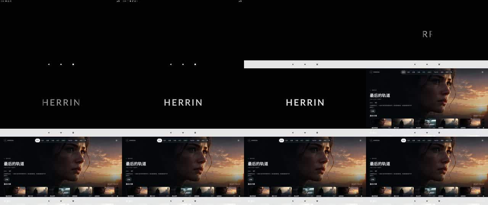

# HERRIN 实机反馈续修台账（2026-11-21）

用户实测 APK 源码为 `68a76b04`，本轮开始时 GitHub / 本地均为 `5f294304`。继续原分支与 Draft PR #85。**用户已在真机复现 H-001、H-005、H-006、H-008、H-013；它们均未完成，旧自动化通过不能作为本轮用户功能验收。**

最新代码与验证：当前完整测试源码 `8be5f820feba2a5ccde8ad35e58daa9297dd9377`，最后生产修改 `711cfad5`（H-001真实偏好覆盖修复）。[CI44971925041](https://github.com/shawnhhh/aura-tv/actions/runs/44971925041)首次JVM808/808通过，但Lint依赖解析受阻，已请求同SHA失败作业重试一次。当前尚无包含711修复的新CI诊断包；下文7845/18cbc/82b4均为明确标注的历史源码，不能当作当前版本完整通过或最新包。

原 H-001～H-009 问题与历史证据保留在 [原台账](H-001-H-009-20261120.md)。本页合并新增实机反馈，并新增 H-010～H-013，无任何“已验收”项。没有使用子代理、Superpowers、第二播放器或模拟扫码；没有合并、强推或新增 PR。

## 逐项实际开发

代码路径前缀：`android-tv/app/src/main/java/tv/herrin/app/`。本轮统一 CI 的源码 SHA 与结果将在下方单独记录，开发过程的日志不冒充最终源码全量通过。

| 编号 / 实机现象 | 原因或实际证据 | 实际修改文件与提交 | 当前状态 / 真机验收 |
|---|---|---|---|
| H-001 首装黑屏、静态字标，第二次正常 | 原时钟按两次 vsync 的绝对时间相减，初始化长帧可以消耗显影；安装器持续 OK 可被当作跳过；系统 Splash 原先额外等待下一次 pre-draw。新查明MainActivity首页SideEffect会把StartupHost已读取的应用内偏好覆盖成user||system，在系统动画比例0时中途切换静态模式。是可确认的代码缺口，尚不能把它们全部认定为 TCL 实机唯一根因 | `WordmarkFrameClock.kt`、`HerrinWordmarkSplash.kt`、`StartupPresentation.kt`、`MainActivity.kt`：绘制/窗口可见后开始，长帧最多推进64ms，不追赶跳过阶段；首装完整交接后才保存可跳过标记，忽略长按重复键；系统层立即移除。`MainActivity.kt` 711cfad5改为只回写应用偏好；`StartupMotionPreferenceTest.kt` 两个真实Activity/系统设置参数场景，确认首页SideEffect已执行后仍保持明确偏好，测试后恢复系统设置。a58de348、a58bdd89、711cfad5、8be5f820。V13 Motion/矢量路径无设计修改，后台网络仍在动画期间开始；卸载释放保留 | **未完成：711偏好覆盖修复已提交，8be统一CI待完成，首装TCL仍待验收**。补充全新数据、离线、已配置、force-stop、热恢复专项；正常 API31 与 Compose 自动时钟结果分开 |
| H-002 遥控器焦点 / H-003 Hero 仅详情 / H-004 可信节点与真实线路 | 原焦点恢复、延迟目标、独立重试、失败投影清理保留；7845另保护详情/待播期间的索引通知，不清空正在重绑的来源路由，需要新完整回归 | 保留原编号、文件及提交；`PersonalLibraryIndexChanges.kt` 的7845新增事务保护；个人字段上下移动处理见H-008 | 未重新开发，旧289项通过绑定3e1da724；不写成当前 SHA 已通过；待本轮回归及真机 |
| H-005 玩偶哥哥无真实授权二维码 | 已检出固定 FongMi/TV `305dff233cde512e2c83f71529b7c3ecfd61fefc`；核对 `App.java`、`SiteApi.java`、`VideoViewModel.java`、`Source.java`、`SpiderDialog.java`、`catvod Runtime/Dialog`。QR、分享资源和扫码状态由实际 Spider / 原回调拥有，没有通用“扫码即成功”分支。默认 app 仍未启用独立 whole-kernel adapter；`TvBoxSpiderBridge.kt:552,585` 的隔离宿主 Activity supplier 仍返回null，依赖真实Activity的插件流程未补齐，不能把Dialog IPC契约当作完整网盘登录 | `SpiderAuthorizationProtocol.kt` / `SpiderAuthorizationHost.kt`：按真实 SpiderDialog 补齐 select/textarea、来源初始值和 values 更新、选择白名单与取消隔离；沿原 Runtime→IPC→根授权窗口回传，不生成二维码内容或登录状态。6012faaf。保留 GPL 来源、许可证及 pinned submodule | **开发中 / 原adapter环境阻塞；7845相关恢复竞态待新测试**。缺MPV/FFmpeg/hook/tvbus和匹配 custom Media3；本地 wrapper 分发域名解析失败，未进入 adapter Java 编译。真实饭太硬配置 HTTP403，未执行第三方插件、扫码或首帧；TCL 玩偶哥哥/奶酪待验收 |
| H-006 手机扫码导入失败、中文名乱码 | 浏览器 fetch 的 application/json 不声明 charset；旧 NanoHTTPD parseBody 使用默认字符集。配置生效还会等待节点/直播探测；合法短链被拒 | `LanJsonBody.kt` / `LanConfigServer.kt` 显式有界 UTF-8、静态资源 UTF-8；`TvBoxWarehouses.kt` 支持配置 HTTP(S) 跳转且按最终 origin 解析，正文仍限制1MiB；`MainActivity.kt` 解析成功后独立激活，不等 Spider/空目录，失败保留旧根。35418f1a、efa6aded。TLS/配对/Origin/会话规则保留 | **未完成：代码已修改，待真实 iPhone→TV 验收**。实际第三方配置请求403，不能写成成功导入 |
| H-007 异步模块反馈 / H-009 黑色极简 | 原请求归属、密码清理和黑色 UI 保留；授权反馈移到右上角；只读 browse/search 不再触发 NAS 配置撤销，保护正常播放 | `LanConfigServer.kt`、`SpiderAuthorizationHost.kt`；按原 module/owner 隔离，无技术管理页或屏幕返回键 | 待统一回归及真实 Safari/TCL |
| H-008 端口缺失、中文乱码、二次导入、TV浏览空白 | TV/手机原字段不一致，添加只保存连接；TV browse 使用闭包状态作为请求身份，结果可能被丢弃 | `PersonalStoragePolicy.kt` / `PersonalLibraryApi.kt` / `PersonalLibrarySettings.kt` / `assets/config/center.html,center.js`：名称→服务器→端口→路径→用户→密码→添加；URL/IDN/默认80或443/独立端口、显式冲突拒绝、遍历在归一化前拒绝；请求按自身 ID/path 归属；添加验证后自动导入明确子树，无路径不扫描整盘；同一目录能力；真正空目录有固定提示，失败仅 toast。8221b8e8、efa6aded、72cefc35 | **未完成：代码已修改，待阿里云盘 WebDAV 与 TCL 目录/遥控器验收**。不降低 TLS；UTF-8 已有专项与浏览器证据 |
| H-010 影视仓加载/切换慢（新增） | 手机生效等待首个 CMS/Spider，以及串行直播备份；仓库切换没有利用已有缓存 | `MainActivity.kt` 新导入只发布仓库/站点元数据，不自动深度初始化；启动仅恢复旧选择；切换缓存优先、后台刷新，不覆盖当前 UI；旧 effect 取消及 ticket 保留。`TvBoxWarehouses.kt` 增加响应/解析 MS 阶段日志。35418f1a、a1edae98、f50e2aa1 | 代码已修改待测试；真实网络前后性能数据未取得，不能声称定量优化验收 |
| H-011 原文件名、H占位、无分类/资料（新增） | 原 parse 只看文件名；自动刮削只保存搜索结果部分字段，个人内容只进入“我的”，版本不聚合 | `PersonalStoragePolicy.kt` 支持父文件夹、季目录、中文集标记与技术标签清理；`PersonalNfoIdentity.kt` / `PersonalRemoteFiles.kt` 通过同一凭据有界读取 NFO（100个/轮、64KiB），拒绝DTD/实体，区分集ID与作品ID；`HerrinTmdbDiscovery.kt` 官方详情/credits；`PersonalMediaIndex.kt` 无损升级元数据列；`PersonalMediaProjection.kt` 保存背景/评分/演员导演并按真实 ID/季集聚合版本，原文件ID/路径保留；MainActivity 投影识别内容到电影/剧集/动漫/纪录片，“我的”保留所有个人内容；遥控器 Menu 调用 `PersonalMatchDialog.kt` 搜索并选择官方结果，复用原匹配 API。a1edae98、dc1e12a0、d42af6d0、64a120f5 | **开发中，待统一与实库验收**。保守精确别名/年份；无Token/网络或歧义保留索引和后台原因。繁简等价召回、复杂动漫/Part、超大库全量分页及真实片库命中率尚未证明；人工纠正目前保存搜索基本资料并清除旧资料，不保证自动补齐新作品全部演职员/背景；没有匹配率假数据 |
| H-012 新增文件自动同步（新增） | 原扫描仅首次/手动导入触发，持久化增量能力未接周期入口 | `PersonalLibraryIndexChanges.kt` 7845延后事务中的纯索引缓存失效；`PersonalLibraryStartupImport.kt` / `PersonalSyncPolicy.kt` 启动检查已导入且启用的目录，约30分钟检查一次，串行复用现有扫描；手动刷新保留；只有完整成功遍历才标记删除，未变文件/人工纠正保留；扫描与刮削衔接，失败不清空。a1edae98、dc1e12a0 | 代码已修改待测试；30分钟真实运行、离线/改名/新增及播放并发待真机；不是独立后台媒体库 |
| H-013 WebDAV 文件误报影视源网盘授权（新增） | 个人失败共用 Spider 提示和来源恢复；302 被 header probe 一律拒绝；瞬态 URL/map 丢失后无法从索引重建 | `HerrinPersonalPlaybackGate.kt` / `HerrinPersonalMediaProbe.kt` / `PlayerStartupHints.kt` / `PlayerStartupSurface.kt` / `MainActivity.kt`：按真实文件ID从已保存连接重新建立每次播放/重播/切集请求，Range 与媒体字节检查保留；有界解析服务器重定向，跨域移除凭据、拒绝HTTPS降级；PERSONAL_AUTH/READ失败独立提示；不走Spider、影视仓恢复或测试媒体；全部仍交唯一 FongMi/Media3。322adefc、a1edae98、1fffcc18 | **未完成：代码已修改，7845事务保护待新完整回归；真实阿里WebDAV首帧、拖动、暂停/续播、401/403仍待验收**。受控字节/Range测试不能冒充个人云盘播放成功 |

## 当前统一 CI 与源码绑定

历史定向诊断提交 `18cbc73aed4490755e54f1cdea98405cb413008e`，[定向诊断CI 44966779706](https://github.com/shawnhhh/aura-tv/actions/runs/44966779706)。这是续播4项×3轮与API31专项，**不是全量TV验收**；最新全量仍绑定7eff2495 / CI44963889759。上述旧诊断提交的应用/JVM/构建输入与 `82b4fc7b5e519625710f7e5ca5b165b1d72f3f3e` 一致；此历史复用不适用于后续修改生产逻辑的7845。旧累计差异门禁记录在 [ci-test-only-scope.json](validation-20261121-device/ci-test-only-scope.json)。复用的是已完成的 [82b4 / CI 44921354185](https://github.com/shawnhhh/aura-tv/actions/runs/44921354185) 的 **JVM807/807、0失败/错误/跳过，Samba6/6、Lint/Debug通过**，不是当前测试提交重新执行。7eff TV/API31实际重新执行但仍失败，18cbc只执行明确标注的续播诊断和API31，不跑全量。ABBA仅保留下方4c7a已完成结果，不冒充新执行。

`11c3f731` 曾通过JVM806/Lint/Debug，但TV首个H-004预回归在 `awaitAppliedWarehouse` 等待15秒失败，未进入无过滤全量。原因是旧测试要求配置导入自动激活节点；新需求要求节点按需选择。`9c05ad22` 保留配置持久化检查，将真实节点激活/workingRoot/workingSite检查移到实际UI选择节点之后；导入请求数严格为1，选择后仍为2；全部详情、媒体首帧、恢复、授权和失败重试断言保留，未增加超时。`82b4` 的旧TV批次被测试修正替代，不能写成全量通过。见[具体失败](validation-20261121-device/ci-11c3-tv-failure.log)。

`5f90fd41` 的详情单项1/1、V13像素单项1/1、组合预检20/20已通过；脚本仍要求旧的19项，门禁因此退出，未执行完整TV/API31/ABBA。`dc2d623e` 将精确期望更新为20，没有删除断言或放宽失败检查；[计数失败证据](validation-20261121-device/ci-5f90-preflight-count.json)。该脚本只控制TV执行，JVM与构建输入仍与82b4一致。

`dc2d623e` 历史20项预检18/20：详情重试选线后播放入口等待超时，根因仍在定位，保留原断言/10秒预算并补充受控请求与UI树诊断；手机失败候选返回错误code，是旧FIFO中多余CMS响应未被消费。`e9e6bea0` 将后者改为配置激活严格只有1请求，保留403/无效JSON/空多仓错误与旧配置断言，最终严格4请求且无CMS。见[原失败日志](validation-20261121-device/ci-dc2d-tv-failure.log)。`4c7a907e` 使独立API31/ABBA在上游测试失败后仍串行执行；失败状态保留，没有continue-on-error或验收门禁放宽。

### 711cfad5 / 8be5f820：H-001偏好覆盖的实际代码缺陷

`StartupHost`在IO准备中已明确只读HERRIN的reducedMotion；但 `MainActivity.kt` 首页SideEffect又执行 `startup.reduced = reduceMotion`，后者是应用偏好与系统ANIMATOR_DURATION_SCALE的合并值。系统比例0时，首页开始构造即可把仍在显影中的V13切入静态路径。这不是增加提前ready标志，而是修正同一生命周期状态的错误来源：改为 `startup.reduced = reduced`，普通首页UI仍按原规则尊重系统减少动态效果，Splash继续按明确应用偏好。

新增真实MainActivity参数回归：系统比例0且应用选择完整动画、系统比例1且应用选择减少动态效果。通过实际Settings服务设置与恢复原值，读取Activity自身presentation，等待真实首页SideEffect回调存在后检查，没有注入动画完成或首页ready。原像素/亮度/时长断言保留；完整TV门禁要求包含新类。`8be5f820` 本地AndroidTest编译通过（不是执行通过），见[startup-motion-compile.json](validation-20261121-device/startup-motion-compile.json)。

同批H-004旧测试只等待服务端收到a/b详情请求便点击菜单，未等响应解析和可信布局发布。7845事务+原续播5项通过，随后20项预检19/20因source-node-menu不存在失败，未运行无过滤全量；见[原失败](validation-20261121-device/ci-7845-tv-preflight-failure.json)。8be将“请求已收到且真实菜单可见”同时纳入原15秒预算，保留所有原请求、选线、失败重试和不得预解析媒体断言，未延长等待。

8be首次执行：真实Samba先行通过、JVM808/808无失败/错误/跳过；Lint尚未开始代码分析就因四个既有Maven依赖报ModuleVersionNotFound而失败，未构建APK/执行TV。工作区对四个相同官方POM做HEAD均HTTP200，证明版本存在，不是Lint通过。已仅请求一次同SHA失败作业重试，不改版本、不关闭Lint、不删除断言。见[阻塞原证据](validation-20261121-device/ci-8be5-attempt1-dependency-block.json)和[完整模式输入边界](validation-20261121-device/ci-8be5-scope.json)。新Main生产输入已变，本批JVM/Lint/Debug/TV/API31/ABBA全部重新验证，不复用7845为新通过。

新增TV作业只在完整套件成功后打包实际测试的同一app-debug.apk，附源码SHA与APK SHA-256，名称明确diagnostic；不是正式验收。真实饭太硬导入将使用原有live test在当前完整流程结束后串行执行，不与本批模拟器并跑。

### 7845beca 生产代码续修：索引更新保护播放事务

前一批生产代码 `7845becad0700f737b3c808cc32bfce0e65fc627`。原归档确认7eff失败发生在详情返回后、播放器建立前，没有MEDIA_READY/解码错误，不能描述成Media3已启动不出帧。代码核查确认 `PersonalLibraryIndexChanges` 之前仅保护player，后台扫描在detail或play-intent期间仍会清空路由、重启检索。现在将detail→play-intent→player作为同一事务延后纯索引失效，回浏览页后合并更新一次；真正配置/授权变化仍由原配置epoch即时撤销，未放宽鉴权。

修改 `PersonalLibraryIndexChanges.kt`、`PersonalIndexRevisionTest.kt`、新增 `PersonalIndexTransactionTest.kt`，完整TV门禁强制包含该新类，旧续播首帧/30秒等待与错误断言未改。本地仅失败专项 **2/2** 通过，源码绑定见[index-transaction-targeted.json](validation-20261121-device/index-transaction-targeted.json)。关联H-004/H-005/H-012/H-013。该竞态与失败阶段相符，但不能未经新回归就声称是原失败唯一原因。

7845最新已完成：[完整JVM **808/808，0失败/错误/跳过**，Samba6/6、Lint/Debug通过](validation-20261121-device/ci-7845-debug.json)。该批TV仅到预检失败，未跑全量；API31与ABBA已独立完成，结果见ci-7845-independent.json。它们不含后续711偏好修复。

7845实际诊断APK：[Artifact14732338316](https://github.com/shawnhhh/aura-tv/actions/runs/44968547697/artifacts/14732338316)，构建源码 `7845becad0700f737b3c808cc32bfce0e65fc627`，27,119,346字节，CI APK SHA-256 `900a37ada5c185a63ba25c6ecacc3fd8740efe0577cd811dcd7bd1cf9da39fbb`，内有SOURCE_COMMIT.txt与SHA256SUMS.txt；未独立下载验算，非正式验收包。

**生产输入已变，旧807项与ABBA不再作为当前生产版本通过。** 当前[完整CI44968547697](https://github.com/shawnhhh/aura-tv/actions/runs/44968547697)绑定7845，实际执行完整JVM/Lint/Debug、事务+原续播5项先行、无过滤TV、API31与ABBA，不使用定向诊断模式。18cbc诊断APK也不含本次防护，不能重标为7845最新包。

### 18cbc实际诊断与API31已完成（非全量TV）

续播4项三轮 **12/12通过**，未复现7eff失败；**不代表全量恢复**。API31冷启动/热恢复/首数据断网录像/force-stop/已配置断网均通过，实际51帧。冷启动CPU指标：首页8035ms、网络2777ms；首数据离线视觉轮：首页7012ms、网络2211ms。旧7eff快照实际只有Splash字标的content-desc，没有首页；新探针按真实交接同步后才检查，未放宽焦点/详情/最小时长/网络条件。

已使用[原证据只读检查CI44967834737](https://github.com/shawnhhh/aura-tv/actions/runs/44967834737)读取旧失败时段、新真实录像与trace，未重跑媒体。完整记录见[原事件与快照](validation-20261121-device/ci-original-evidence-inspection.log)、[18cbc结果](validation-20261121-device/ci-18cbc-results.json)。trace出现软件GPU swap约3020ms、JIT约2607ms和主线程draw约1998ms，说明本模拟器有明显长帧；这不是TCL根因或提速证明。



图为真实API31手机系统镜像的横屏模拟器录像，含系统栏，非TCL面板；已肉眼核对中心显影、增亮、黑底固定字标和首页过渡，1fps稀疏帧不能量化精确动画时长或呼吸曲线。TCL首装仍未验收。

18cbc诊断包：[Artifact14731903697](https://github.com/shawnhhh/aura-tv/actions/runs/44966779706/artifacts/14731903697)，源码 `18cbc73aed4490755e54f1cdea98405cb413008e`，CI APK SHA-256 `d536ce3d41b8951b6d0b92293cf81d81073c563a5a1cd9232267322cb8f0af79`，未独立下载验算，非正式验收；**不含后续7845修改**。

### 7eff2495 实际全量与新增续播失败（2026-11-22 UTC）

最新无过滤TV **292项，291通过1失败**，无进程fatal。合法短链修正专项与全量均通过。唯一失败改为 `P0RecentPlaybackReturnTest.myContinueWatchingDirectlyDecodesAndReturnsToTheSameCard:98`，30秒内未显示 `player-root-focus`，尚未到媒体/解码层（此前按用例名概括成首帧超时不准确，以7eff源码98行及原归档为准）；**播放恢复问题未完成，未加长等待或删除真实解码断言**。18cbc只增加受控原始请求/播放阶段/界面树失败证据，定向4项重复3轮，不把专项通过代替292项全量。当前原归档下载在工作区URLError，将使用现有GitHub证据检查workflow读取原时段，不重新播放媒体。

API31旧批确已取得有效XML，但品牌断言失败；日志在该观察后才记录首页完成，activity_to_home=12276ms、wordmark_visible=4373ms、network=5512ms。这是慢首装下固定sleep5的观察相位问题，尚未用原快照逐节点复核；不把12.3秒写成提速。18cbc探针先在固定15秒同步预算内等待真实交接事件，再抓一次新UI，原界面/焦点/最小时长/网络时序检查不变。错误完成事件或崩溃立即失败，缺失事件到期失败，未增加UI条件重试；新增负向3/3通过。代码侧首次黑屏仍需TCL实机复验。

[本批结果](validation-20261121-device/ci-7eff-results.json)、[292项明细](validation-20261121-device/ci-7eff-tv-summary.json)、[API31原失败](validation-20261121-device/ci-7eff-api31-failure.log)。7eff实际新诊断APK：[Artifact14731297837](https://github.com/shawnhhh/aura-tv/actions/runs/44963889759/artifacts/14731297837)，源码 `7eff2495c75aa76daf4b59a3a520c146090f95d6`，CI APK SHA-256 `ab6d3a2131b2e04bc3a2e7d367d366b8d8e4a2d38fd6c44f71663de890c0aa99`，未独立下载验算，非正式验收包。ABBA仅保留4c7a既有四轮证据，没有在7eff重复执行。

### 4c7a907e 实际全量及剩余失败

[CI 44924819337](https://github.com/shawnhhh/aura-tv/actions/runs/44924819337)：AndroidTest编译通过，4组预检1/1、1/1、20/20、20/20通过。TV无过滤全量 **292项、291通过、1失败、无进程fatal**。唯一失败 `TvBoxWarehouseIntegrationTest.refusesRedirectsHtmlAndOversizedPayloads:136`：旧断言要求所有重定向都失败，与本轮合法短链接需求冲突。`406330c1` 保留非HTTP跳转、图片及1MiB拒绝断言，新增合法短链、最终相对CMS路径和HTML拒绝检查，下一批先复测此项后再全量。没有删除有效安全断言。

H-004详情重试在此批预检及全量均通过；上一批dc2d的间歇超时**未定位、没有生产修复**，不能因新批次通过而宣布根治。仍保留失败与新增的受控请求/诊断/UI树捕获。

API31作业失败在UIAutomator抓取：`null root node`，拉取的内容不是XML，故ParseError；尚未通过真实UI/窗口/焦点验收。日志有首页完成9355ms、network3346ms、完整动画事件，但不能用日志替代有效界面观察。`406330c1` 只对无效/缺失XML做最多3次全新抓取，保留每次失败，不复用旧XML；一旦有效XML不符合界面条件仍立即失败，原动画最低时长、焦点、详情按钮与网络时序断言保持。抓取负向专项3/3，原启动检查器11/11，调度边界11/11通过。

ABBA **成功，A1/B1/B2/A2每轮6项**，基线599d58d8、候选4c7a907e，同一API30 x86 SwiftShader模拟器。首绘均值683.5→722.5ms（+39ms），首页2472.5→2392.5ms（-80ms），11次缓存导航3619.5→4279.5ms（+660ms，回退）。包含Compose测试同步，非真实遥控key-to-photon，不能声称TCL提速。`7eff2495` 仅在相对已验证4c7a的变更严格限于这一个仓库测试和指定启动/调度脚本时复用；任何app/依赖、其他AndroidTest或ABBA runner改动均拒绝复用。具体[结果与失败](validation-20261121-device/ci-4c7a-results.json)、[292项明细](validation-20261121-device/ci-4c7a-tv-summary.json)、[ABBA完整数据](validation-20261121-device/ci-4c7a-abba.json)。

已真实上传4c7a ABBA候选诊断包 [Artifact14716218590](https://github.com/shawnhhh/aura-tv/actions/runs/44924819337/artifacts/14716218590)，源码4c7a完整SHA同上，CI APK SHA-256 `3b10727e2519fa8cc7adb1718183b25827552f46ff22560c9c0bf4041e234737`。这是另一作业实际新构建的包，不将82b4旧hash贴到新包；未独立下载验算，非正式验收。当前7eff批次若生成新包将追加精确绑定。

补充代码：`11c3f731` 的播放器内个人媒体重试会重取保存连接，不复用CDN过期地址；个人连接反馈为右上角短暂提示。`336dfb40` 区分TMDB movie/tv数字命名空间，防止动漫电影和剧集ID碰撞被错误合并；保留来源选择项的真实安全名称与纵向滚动。`82b4fc7b` 人工纠正清除旧作品演员/背景/原类型，避免显示旧资料。

### 历史82b4生产代码诊断包（不含后续7845防护）

[Artifact 14714680455](https://github.com/shawnhhh/aura-tv/actions/runs/44921354185/artifacts/14714680455)，构建源码 `82b4fc7b5e519625710f7e5ca5b165b1d72f3f3e`，27,119,346字节，CI APK SHA-256（非ZIP digest）：

```text
22909f4752c0e598009318a065fa473d5c1deb5d152b3fb30b43b5ac73ff2844
```

包含 SOURCE_COMMIT.txt / SHA256SUMS.txt。[实际CI日志与807项汇总](validation-20261121-device/ci-82b4-debug.json)。尚未独立下载验算；工作区下载报告引用失败为URLError，未绕过网络限制。此包为诊断，非正式验收。后续API31作业若生成当前测试提交构建将按其实际hash单独记录，不把82b4重标成当前HEAD。

## 开发期验证记录

本轮代码提交截至 `186f24d6`；补充 `81124cad` 保留已识别分类、修复旧未匹配索引回填并撤销变更远端身份的旧索引，`885f2aa9` 按最终配置 origin 解析相对多仓/站点/扩展/JAR并持久化缓存 origin，加入真实 Activity→受控 HTTP→配置生效、不得请求CMS的专项。原有播放、权限、线路、Range、恢复断言未删除。

- 首轮开发期 JVM 实际 **803项，802通过，1失败**：`PersonalStoragePolicyTest.fullWebDavUrlsPreserveProtocolPortAndBaseDirectory`。HTTP URL库归一化掉 `%2e%2e`，已在归一化前检查修复，失败专项后通过，断言保留。见 [原失败XML](validation-20261121-device/PersonalStoragePolicyTest-round1.xml)、[失败日志](validation-20261121-device/jvm-round1.log)、[专项](validation-20261121-device/targeted-fix.log)。开发中工作区仍在修改，这些日志只作为诊断，不绑定最终HEAD全量通过。
- 真实受控 Samba 1445/1446 已启动；不是删除/跳过旧失败断言。
- JS语法、Chromium手机表单回归、Python静态与39项脚本测试已运行；启动检查器新11项专项另存。浏览器使用mock API，不是Safari或Android服务器端到端通过。
- `81124cad` 的8组失败/新增专项 **31/31** 通过，见 [精确专项汇总](validation-20261121-device/targeted-summary.json)。较后的相对配置解析与 Activity专项仍需CI。`7045e9aa` 的本地 Debug / AndroidTest 构建通过，见[源码与本地包绑定](validation-20261121-device/local-build.json)；该中间包不冒充最终交付。
- Lint 首轮 `SuspiciousIndentation` 失败保留在[日志](validation-20261121-device/lint-round1.log)，已补齐HTTP分支括号，未禁用检查；最终由统一CI核验。新增测试曾因 `Dns` 接口写法编译失败，修复为实际接口实现后31项通过，原[编译失败日志](validation-20261121-device/final-targeted.log)保留。
- 原kernel的 source门槛已补齐，但 native/Media3门槛仍 BLOCKED。见 [依赖报告](validation-20261121-device/adapter-preflight.json)、[独立构建尝试](validation-20261121-device/adapter-build.log)。契约不等于编译和首帧。
- [真实饭太硬取配置](validation-20261121-device/real-warehouse.json)：HTTP403，仅配置获取阶段，未执行Spider；不绕过403。

## 专项结果与验收边界（不以整批或单项互相替代）

以下TV单项来自4c7a907e的[292项真实结果](validation-20261121-device/ci-4c7a-tv-summary.json)，该批整体仍为291/292失败状态。JVM全部807项来自82b4；两者生产输入相同。最新7eff的重定向修正与API31抓取另待本轮结果，不把旧通过写成新执行。

| 编号 | 已实际执行的自动化范围 | 仍不能验收的部分 |
|---|---|---|
| H-001 | WordmarkFrameClock JVM、HerrinSplashTest像素/并行/退出/首装不跳过、StartupParallelPreparationTest通过 | API31旧批无有效XML；新批待结果；TCL肉眼首装/黑屏/系统交接待复验 |
| H-002 / H-003 | TV快速焦点、独立分类、返回恢复、Hero仅详情等既有用例通过 | TCL物理遥控与厂商IME待验收 |
| H-004 | 4c7a详情重绑与独立重试预检及全量通过；未预解析媒体断言保留 | dc2d间歇超时未定位，不能宣布根治；TCL仍待验收 |
| H-005 | SpiderAuthorizationProtocol JVM及既有受控授权/播放隔离TV用例通过 | original adapter未编译/接入；第三方403止于配置取回；玩偶哥哥/奶酪真实QR→首帧全链路未验收 |
| H-006 | UTF-8、HTTP/短链/最终origin JVM，PhoneWarehouseActivationTest与真实配对HTTPS提交HTTP配置TV用例通过 | 旧拒绝一切重定向测试修正待新批；真实Safari/饭太硬未验收 |
| H-007 / H-009 | Chromium mock API模块/会话/密码回归；TV既有配置与黑色极简相关用例通过 | Safari与真实TV模块切换操作待验收 |
| H-008 | URL/80/443/端口/遍历、中文连接持久化、添加即导入专项；既有SMB/DAV TV用例通过 | 真实阿里云盘目录权限、中文显示、完整表单遥控操作待验收 |
| H-010 | 受控手机配置激活不请求CMS专项通过；缓存与阶段诊断保留 | 无实际远端仓库前后计时；ABBA缓存导航观察反而+660ms，不能声称全面提速 |
| H-011 | 文件/父目录清洗、NFO安全ID、movie/tv命名空间、版本/季集投影JVM；个人DB TV用例通过 | 实库匹配率、复杂动漫/Part/繁简、超大库分页及真实NFO/海报网络待验收 |
| H-012 | 增量索引、完整扫描才删除、离线保留及周期到期策略专项通过 | 真实运行约30分钟、新增/删除/改名与边播边扫待验收 |
| H-013 | PersonalRedirectPlayback JVM实际Range/重定向/凭据剥离/401分类，受控M471 DAV解码/seek等TV用例通过 | 用户真实阿里DAV首帧/seek/续播/重播与401/403界面待验收 |

所有编号均无“已验收”结论；无法在云端执行的真实设备项保留为待真机。H-011仍是开发中，H-005仍有集成缺口。

## 真机验收保留清单

1. TCL全新安装/无数据无配置、已配置、force-stop、再次进入、断网：肉眼完整V13及系统交接；首页出现后动画已卸载。
2. 玩偶哥哥及奶酪：真实资源识别→来源生成二维码→用户扫码→真实轮询状态→playerContent→首帧→重播/切集/换片；保留实际失败阶段。
3. iPhone Safari→配对TV：中文名/IDN、HTTP/HTTPS/短链接、单多仓、错误候选保留旧配置；配置成功与Spider授权分别验收。
4. 阿里WebDAV：竖向字段、端口/完整URL冲突、实际目录/空目录/权限/超时；添加一次即导入所选子树；不扫描整盘。
5. 个人片库：实际首帧、seek/pause/resume、不同版本/季集、断网后保留、401/403不引导影视仓扫码。
6. 真实命名样本/NFO/同名不同年份/多版本/人工纠正；资料/背景海报/分类；新增/删除/改名/失败恢复，运行30分钟增量同步。

只有这些真实流程经用户确认后才可标“已验收”。本轮 Debug APK 仅供诊断；已经生成的生产代码包绑定见上方，TV/API31/ABBA结果继续补充。
